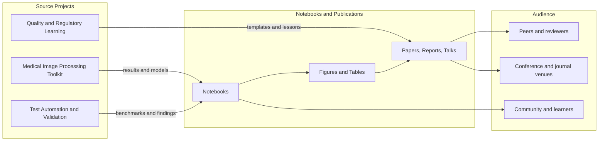
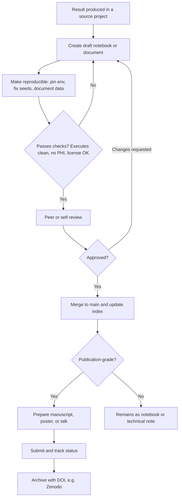
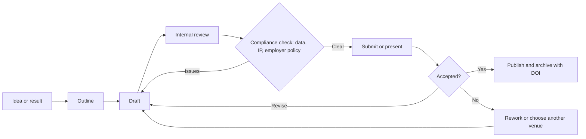
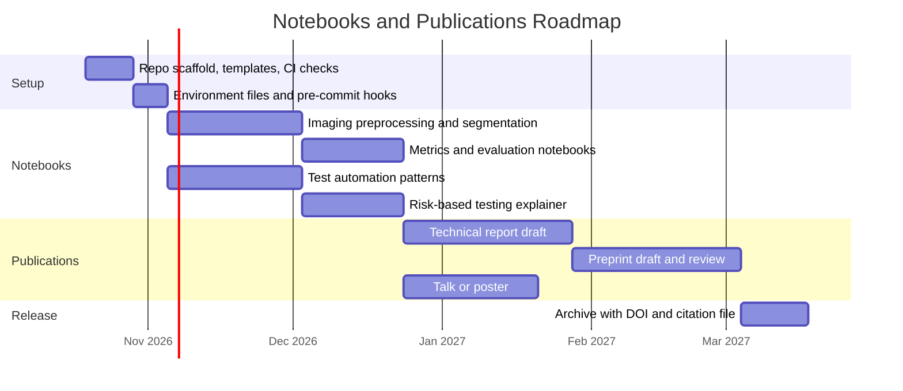

# Notebooks & Publications

> A curated home for the outcomes of my projects: reproducible Jupyter notebooks, technical write-ups, papers, posters, and talks, spanning medical image processing, test automation, and quality and regulatory engineering.


> **Note:** All content here is for research and educational purposes only. It uses public or synthetic data, contains no patient data and no confidential or proprietary employer information, and is not intended for clinical or regulatory use.

---

## Table of Contents

1. [Purpose](#purpose)
2. [How This Repo Fits With My Other Projects](#how-this-repo-fits-with-my-other-projects)
3. [Content Lifecycle](#content-lifecycle)
4. [Repository Structure](#repository-structure)
5. [Notebook Index](#notebook-index)
6. [Publications Index](#publications-index)
7. [Getting Started](#getting-started)
8. [Notebook Standards](#notebook-standards)
9. [Publication Workflow](#publication-workflow)
10. [Release and Review Checklist](#release-and-review-checklist)
11. [Roadmap](#roadmap)
12. [Citing This Work](#citing-this-work)
13. [Contributing](#contributing)
14. [License](#license)

---

## Purpose

This repository is the **output layer** for my project work. Code lives in the individual project repositories; this repo collects what comes out of them:

- **Notebooks:** exploratory analyses, experiments, tutorials, and demonstrations that are runnable end to end.
- **Publications:** papers, preprints, technical reports, posters, slide decks, and blog-style write-ups.
- **Assets:** figures, tables, and small curated datasets that support the above.

## How This Repo Fits With My Other Projects



## Content Lifecycle

Every item moves through the same stages so quality stays consistent.



## Repository Structure

```text
notebooks-and-publications/
├── .github/
│   ├── workflows/                # Notebook execution and lint checks
│   ├── ISSUE_TEMPLATE/
│   └── PULL_REQUEST_TEMPLATE.md
├── notebooks/
│   ├── 01-medical-imaging/
│   ├── 02-test-automation/
│   ├── 03-quality-and-regulatory/
│   └── _templates/               # Notebook starter templates
├── publications/
│   ├── papers/                   # Manuscripts and preprints
│   ├── reports/                  # Technical reports and white papers
│   ├── posters/
│   ├── talks/                    # Slide decks
│   └── _templates/
├── assets/
│   ├── figures/
│   ├── tables/
│   └── data/                     # Small, license-safe datasets only
├── environments/
│   ├── requirements.txt
│   └── environment.yml
├── docs/
│   └── style-guide.md
├── CITATION.cff
├── CONTRIBUTING.md
├── LICENSE
└── README.md
```

## Notebook Index

Add one row per notebook when it is merged. Keep the table sorted by theme, then date.

| # | Title | Theme | Source project | Data | Status |
|---|-------|-------|----------------|------|--------|
| 01 | _Retinal image preprocessing walkthrough_ | Medical imaging | Medical Image Processing Toolkit | Public fundus | Planned |
| 02 | _Vessel segmentation: classical vs U-Net_ | Medical imaging | Medical Image Processing Toolkit | DRIVE | Planned |
| 03 | _Metrics deep dive: Dice, IoU, calibration_ | Medical imaging | Medical Image Processing Toolkit | Public | Planned |
| 04 | _Web UI test automation patterns_ | Test automation | Test Automation and Validation | Synthetic | Planned |
| 05 | _Risk-based test selection explained_ | Quality and regulatory | Quality and Regulatory Learning | Synthetic | Planned |

**Status values:** Planned, In progress, In review, Published.

## Publications Index

| Title | Type | Venue / Format | Status | Link |
|-------|------|----------------|--------|------|
| _Example: Risk-based validation for ML imaging pipelines_ | Technical report | PDF | Planned | n/a |
| _Example: Reproducible retinal image preprocessing_ | Preprint | arXiv / Zenodo | Planned | n/a |
| _Example: Lessons from test automation in a regulated setting_ | Talk | Slides | Planned | n/a |

Replace the example rows as items are created, and add DOI links once archived.

## Getting Started

### Prerequisites

- Python 3.10 or newer
- Git
- JupyterLab (installed below)

### Setup

```bash
git clone https://github.com/<your-username>/notebooks-and-publications.git
cd notebooks-and-publications

python -m venv .venv
source .venv/bin/activate         # Windows: .venv\Scripts\activate

pip install -r environments/requirements.txt
jupyter lab
```

Or with conda:

```bash
conda env create -f environments/environment.yml
conda activate nbpub
jupyter lab
```

### Run a notebook non-interactively

```bash
jupyter nbconvert --to notebook --execute notebooks/01-medical-imaging/01_preprocessing.ipynb --output-dir /tmp/nb-check
```

## Notebook Standards

Each notebook should follow this structure so it is easy to review and reuse:

1. **Title and summary:** one paragraph on the question and the finding.
2. **Metadata cell:** author, date, source project and commit, data source and license.
3. **Environment cell:** library versions and random seed.
4. **Data section:** where the data comes from and how it is loaded, with no PHI.
5. **Method and results:** short markdown explanations between code cells.
6. **Conclusions and limitations:** what the result does and does not show.
7. **References.**

Rules:

- The notebook must run top to bottom on a clean environment.
- Clear heavy outputs, or keep only the figures that matter, before committing (`nbstripout` is configured in pre-commit).
- Never commit credentials, patient data, or confidential employer material.
- Link back to the exact source-project version (tag or commit hash) that produced the results.

## Publication Workflow



Before anything leaves this repo for a conference, journal, or public post, check that it does not disclose confidential or proprietary information and that any required employer approval has been obtained.

## Release and Review Checklist

- [ ] Notebook executes cleanly from a fresh environment
- [ ] Random seeds set; results reproducible
- [ ] Data source and license documented; no patient data
- [ ] No secrets, internal URLs, or proprietary details
- [ ] Figures have titles, axis labels, and units
- [ ] Limitations stated honestly
- [ ] Source project version referenced
- [ ] Index tables updated in this README
- [ ] `CITATION.cff` updated if a new citable item was added

## Roadmap



## Citing This Work

If you use anything from this repository, please cite it using the metadata in [`CITATION.cff`](CITATION.cff). GitHub shows a "Cite this repository" button automatically once that file exists.

```yaml
# CITATION.cff (starter)
cff-version: 1.2.0
message: "If you use this work, please cite it as below."
title: "Notebooks & Publications"
authors:
  - family-names: "Sharma"
    given-names: "Rita"
version: 0.1.0
date-released: 2026-10-14
license: MIT
repository-code: "https://github.com/<your-username>/notebooks-and-publications"
```

## Contributing

Suggestions, corrections, and reproducibility reports are welcome.

1. Open an issue describing the notebook or fix.
2. Branch from `main`: `git checkout -b notebook/short-description`.
3. Use the templates in `notebooks/_templates/`.
4. Run `pre-commit run --all-files` and the execution check.
5. Open a pull request and complete the review checklist.

See [CONTRIBUTING.md](CONTRIBUTING.md) for details.

## License

Code and notebooks are released under the MIT License. Written publications and figures may be released under CC BY 4.0 unless stated otherwise in the item itself. See [LICENSE](LICENSE) for details.
